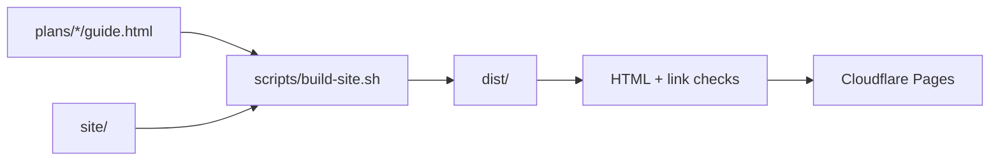

# Whisker & Wrench

<!-- CONSTITUTION_START -->
[](https://github.com/esanacore/engineering-constitution)
<!-- CONSTITUTION_END -->
[](https://github.com/esanacore/whisker-and-wrench/actions/workflows/site.yml)

Tools, plans and software to help animal shelters and animal control. Website: [whiskerandwrench.com](https://whiskerandwrench.com).

## Current Capabilities

- **Website** (`site/`): home page, build plans index, 404 page. Plain HTML and CSS, no framework, dark mode, works on phones.
- **Plan 001: PVC Shelter Cot** (`plans/001-shelter-cot/`): an interactive, LEGO-style build guide for a raised dog cot made only from big-box plumbing parts. Served at `/plans/001-shelter-cot/`. Draft, not yet build-tested.
- **Automated checks**: every push builds the site, validates the HTML, checks internal and external links, and runs the engineering constitution's checks.
- **Auto-deploy**: pushes to `main` deploy to Cloudflare Pages once the checks pass.
- **Software**: research only so far (see `docs/`).



## Quick Start

Supported platforms: Windows, macOS, Linux.

You need Git, Node.js 22+, Python 3, and Bash (Git Bash on Windows).

```bash
git clone --recurse-submodules https://github.com/esanacore/whisker-and-wrench.git
cd whisker-and-wrench
npm ci
```

## Run

Build the site into `dist/`, then serve it at http://localhost:8788.

<details>
<summary>Windows (PowerShell)</summary>

```powershell
bash scripts/build-site.sh
python -m http.server 8788 --directory dist
```

</details>

<details>
<summary>macOS and Linux</summary>

```bash
bash scripts/build-site.sh
python3 -m http.server 8788 --directory dist
```

</details>

You can also open `plans/001-shelter-cot/guide.html` straight in a browser. Use the arrow keys or swipe to step through.

## Test

Same command on every platform (use Git Bash on Windows):

```bash
bash scripts/test-site.sh
```

It builds `dist/`, validates every page with html-validate, checks every internal link and anchor, and runs the link checker's own tests. CI also checks external links with lychee. See `docs/TEST_PLAN.md`.

## Deploy

Push to `main`. GitHub Actions runs the checks and deploys with wrangler. One-time Cloudflare setup, rollback and DNS notes are in `docs/OPERATIONS.md`.

## Project Structure

<details>
<summary>Show the tree</summary>

```
README.md                     This file
CLAUDE.md                     Context for Claude Code sessions
ROADMAP.md                    Plan series and software roadmap
TODO.md / CHANGELOG.md        Living task list and release notes
site/                         Website source (home, plans index, CSS, headers)
plans/
  LICENSE                     CC BY-NC 4.0 for all build plans
  001-shelter-cot/            Plan 001: guide.html + README spec
scripts/
  build-site.sh               Assemble dist/ from site/ and plans/
  test-site.sh                Full test suite
  check_links.py              Internal link checker
docs/
  business-model.md           Pricing, funding, nonprofit vs LLC notes
  research/                   Market research (furniture + software)
  product/app-vision.md       Admin + adopter app concept
  OPERATIONS.md               Deploy, rollback, Cloudflare setup
  ARCHITECTURE.md, TEST_PLAN.md, ...  Constitution docs
constitution/                 Engineering constitution (git submodule)
.github/workflows/            CI and deploy
```

</details>

## Documentation

- `ROADMAP.md`: what's next for plans and software.
- `docs/OPERATIONS.md`: deploys, rollback, Cloudflare and DNS.
- `docs/ARCHITECTURE.md`: how the site is put together.
- `docs/TEST_PLAN.md`: what's tested and known gaps.
- `docs/research/`, `docs/product/`, `docs/business-model.md`: background.

## Picking this up in Claude Code

```powershell
cd C:\Projects\whisker-and-wrench
claude
```

Claude Code reads `CLAUDE.md` automatically for context.

## Contributing

Built a plan? Found a mistake? [Open an issue](https://github.com/esanacore/whisker-and-wrench/issues). See `.github/CONTRIBUTING.md`.

## License

- **Code** (site scripts, CI, tooling): [MIT](LICENSE).
- **Build plans and guides** (everything in `plans/`, and the plan pages on the site): [CC BY-NC 4.0](plans/LICENSE). Build them, share them, adapt them for your shelter, just credit Whisker & Wrench and don't sell them.
