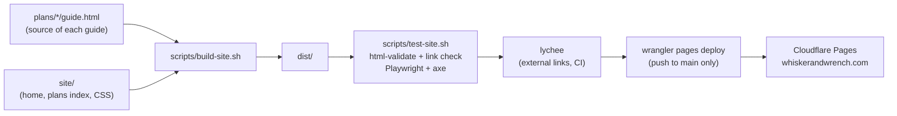

# Architecture

This document provides a high-level overview of how this project is wired and organized.

## System Overview

Today Whisker & Wrench is a static website plus build plans. There is no
server, database or user data. The software products (admin app, adopter app)
are still in research; see `docs/product/app-vision.md`.

## Component Diagram

## Data Flow

1. Authors edit `site/` pages, `demo.html`, or a plan's `guide.html`, `guide.css` and `guide.js`.
2. `scripts/build-site.sh` copies `site/` to `dist/`, `demo.html` to `dist/demo.html`, and each
   `plans/<plan>/guide.html` to `dist/plans/<plan>/index.html` with its `guide.css` and `guide.js` beside it.
3. CI tests `dist/`, then uploads it to Cloudflare Pages on pushes to `main`.
4. Visitors get plain static files. Guides run a small script in the
   browser (the step-by-step viewer); the only data they store is the current
   step number in `localStorage`. All CSS and JS is in files, never inline, so
   the Content-Security-Policy in `site/_headers` can forbid inline code.
   The one exception is `demo.html`, which must be a single self-contained file
   (constitution rule), so the CSP applies only to the rest of the site. The
   `_headers` rules for `/demo.html` and `/demo` (Pages' clean URL) relax it.

## Key Technologies

- **Frontend**: hand-written HTML, CSS and vanilla JS. No framework, no bundler.
- **Backend**: none.
- **Infrastructure**: Cloudflare Pages (hosting, TLS, custom domain), GitHub Actions (CI and deploy).

## Repository Structure

- `site/`: hand-written website pages, shared CSS, logo, `_headers` (security headers).
- `plans/`: build plans. Each plan folder has `guide.html` (visual guide) and `README.md` (plain-text spec). Licensed CC BY-NC 4.0.
- `scripts/`: build and test scripts, plus `serve-dist.mjs` (local server the browser tests use).
- `tests/browser/`: Playwright tests: Plan 001 stepper, 375px layout, axe accessibility.
- `docs/`: research, product notes and constitution docs.
- `constitution/`: Eric's Engineering Constitution (submodule).
- `dist/`: build output. Not committed.

## Layer Boundaries

<!--
Declare this project's layers to turn on Dependency Rule enforcement
(`constitution/scripts/check_architecture.sh`). Until the table below is
uncommented and filled in, layer enforcement is skipped and only advisory
structural signals are reported.

List layers inner-first. "May Depend On" names the layers each one may import;
use an em dash for none. A layer may always import itself, and imports that do
not resolve to a declared layer (third-party and standard-library packages) are
ignored.

The graph must be acyclic: if two layers may each depend on the other,
dependencies cannot point inward and the checker reports a CYCLE. Names in
"May Depend On" must match a declared Layer exactly -- a typo permits nothing
and silently makes that layer stricter than intended, so it is reported too.

Delete the layers that do not apply and rename the paths to match this project.

| Layer          | Path               | May Depend On       |
| -------------- | ------------------ | ------------------- |
| domain         | src/domain         | --                  |
| application    | src/application    | domain              |
| infrastructure | src/infrastructure | domain, application |
-->

<!-- Once this table is real, tighten the constitution-architecture workflow to `--strict`. -->
